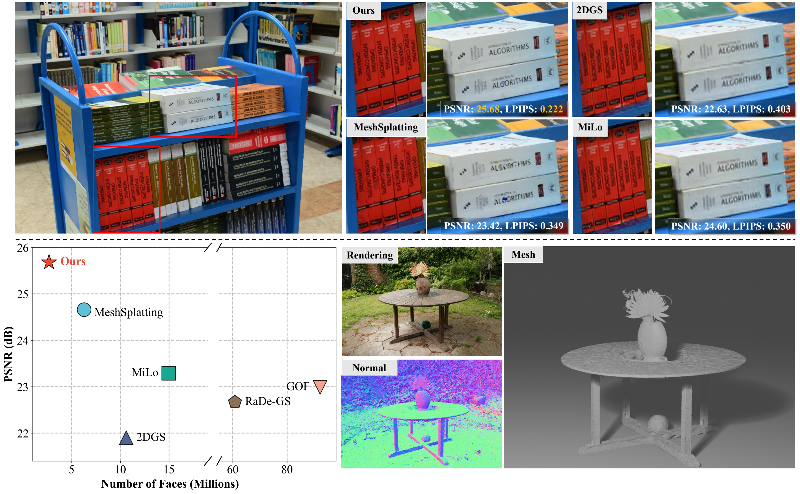

<h1 align="center">T2-Splat: Adaptive Topology Mesh Splatting with Texture Residuals</h1>
<p align="center">
  Zhihao Tang, Youjia Zhang, Mingbo Zhao, Wei Yang
</p>

<br>

 <div align="center">
  <a href="asset/figure.pdf">
    
  </a>
</div> 


## Installation

Requirements: Linux, Python 3.11, an NVIDIA GPU, a CUDA toolkit with `nvcc`, and a C++17 compiler.

```bash
git clone https://github.com/t2-splat/T2Splat.git
cd T2Splat

conda create -n t2splat python=3.11 -y
conda activate t2splat
pip install torch==2.7.1 torchvision==0.22.1 --index-url https://download.pytorch.org/whl/cu126
pip install -r requirements.txt
bash scripts/setup.sh --with-tnt
```

Native extension sources are included in the repository. Set `CUDA_HOME` if the CUDA toolkit is not on `PATH`. The command above also builds nvdiffrast, which is required for default training-view PLY/GLB color baking and Tanks & Temples evaluation. The historical `--with-tnt` flag enables this shared dependency. Omit it only if those operations are not needed.

Before running individual Python programs, load the local extension paths:

```bash
source scripts/env.sh
```

## Data preparation

Prepare each scene in COLMAP format, with images and a `sparse/0/` directory. The pipeline expects these layouts under the dataset root:

- **Mip-NeRF 360:** `<scene>/images_4/` for outdoor scenes or `<scene>/images_2/` for indoor scenes.
- **DTU:** `<scene>/images/`, with masks in `<scene>/mask/`. Evaluation requires `ObsMask/` and `Points/stl/` under `--gt-root`.
- **tandt (train/truck):** `<scene>/images/`, with `<scene>/sparse/0/`; the preset uses `../datasets/tandt` relative to this project.
- **Tanks & Temples (TNT evaluation layout):** `<scene>/<scene>/images/`. Evaluation requires `<scene>.ply`, `<scene>.json`, `<scene>_trans.txt`, and `<scene>_COLMAP_SfM.log` inside `--gt-root/<scene>/`.

### Normal and depth supervision

Optional priors use Metric3D and Depth-Anything-V2. Install their matching dependencies and pretrained weights separately; additional packages are listed in `requirements-priors.txt`.

```bash
python tools/extract_normals.py -s /path/to/garden -i images_4

python tools/gen_da2_depth.py -s /path/to/garden -i images_4 \
  --da2_root /path/to/Depth-Anything-V2
python utils/make_depth_scale.py --base_dir /path/to/garden \
  --depths_dir /path/to/garden/depth
```

Metric3D is downloaded on first use unless cached. Place Depth-Anything-V2 weights in its `checkpoints/` directory. Normal maps follow the image-folder suffix, such as `normals_4/`; depth maps are stored in `depth/` with scale parameters in `sparse/0/depth_params.json`.

## Training

Run the Mip-NeRF 360 pipeline with 8 × 8 face textures:

```bash
bash run_pipeline_mipnerf.sh 0 garden \
  --data-root /path/to/mipnerf360 --output-root output/mipnerf360 \
  --face-tex-res 8
```

The default schedule is 30,000 geometry iterations followed by 5,000 texture iterations. The first positional argument selects the GPU; the second selects a scene, a comma-separated scene list, or `all`.

For DTU and Tanks & Temples:

```bash
bash run_pipeline_dtu.sh 0 scan24 \
  --data-root /path/to/DTU --gt-root /path/to/DTU
bash run_pipeline_tnt.sh 0 Barn \
  --data-root /path/to/TNT --gt-root /path/to/TNT/evaluation
```

The scripts run training and the configured rendering, evaluation, and mesh export stages. Parameters are defined in `configs/common.yaml` and the dataset-specific YAML files.

## Custom datasets

For your own photos, use [COLMAP](https://colmap.github.io/cli.html) to extract features, match images, reconstruct camera poses and sparse points, and run `image_undistorter`. Use the exported undistorted images together with their corresponding camera model. The loader supports `PINHOLE` and `SIMPLE_PINHOLE` cameras.

Arrange the scene as follows. If COLMAP exports model files directly under `sparse/`, place them in `sparse/0/`:

```text
/path/to/custom_dataset/
  my_scene/
    images/                  # Undistorted images
    sparse/0/
      cameras.bin
      images.bin
      points3D.bin
```

COLMAP text models (`cameras.txt`, `images.txt`, `points3D.txt`) are also supported. Keep image filenames consistent with the reconstruction and use a flat image directory with unique filename stems. Normal and depth priors are optional; generate them for the prepared scene as described above.

Create `configs/custom.yaml` to add your scene to the Mip-NeRF 360 training preset:

```yaml
data:
  root: /path/to/custom_dataset
  output: output/custom
scenes:
  my_scene:
    kind: outdoor
    images: images
    max_points: 4000000
```

Use `kind: indoor` for the indoor preset and adjust `max_points` for your scene and GPU memory. `root` is the parent of `my_scene`, not the scene directory itself.

```bash
bash scripts/run.sh mipnerf360 --config configs/custom.yaml \
  --gpu 0 --scenes my_scene --face-tex-res 8
```

This command runs geometry training, texture refinement, rendering, image evaluation, and mesh export. Outputs are saved under `output/custom/my_scene/`, including `mesh.ply`. The pipeline holds out every eighth registered image, sorted by filename, for evaluation. Select custom scenes explicitly with `--scenes`, since the extra configuration extends the preset's scene list.

## Rendering and mesh export

**PLY:** Bake SH and MipTex into vertex colors while preserving the original vertices and faces.

```bash
python create_ply.py output/mipnerf360/garden --iteration 35000 \
  --out output/mipnerf360/garden/mesh.ply
```

**GLB:** Bake SH and MipTex into embedded textures for Blender and other glTF viewers, keeping the triangle count unchanged.

```bash
python create_glb.py output/mipnerf360/garden --iteration 35000 \
  --out output/mipnerf360/garden/mesh.glb
```

Use the saved iteration corresponding to your model.

## Contact

Project maintenance: **zhtang2004@gmail.com**.
